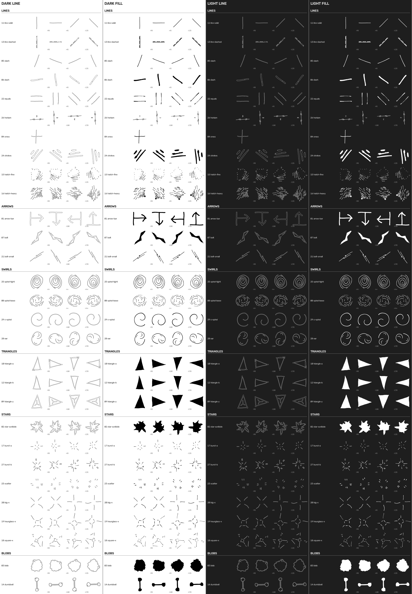

# hand-icons

29 hand-drawn marker icons by Kevin Patton, traced from the sketchbook and shipped as one SVG sprite.
Line and fill variants, rotated or mirrored siblings for anything with a direction, `currentColor`
throughout so they take the text colour and invert with `color: #fff`.

**[Browse the catalog →](https://studio0rpiment.github.io/hand-icons/)** — filter, preview on light/dark, click to copy a snippet.



## Install

```sh
npm i hand-icons        # React / Vite / any bundler
```

or grab `dist/hand-icons.svg` + `dist/hand-icons.css` from a [release](../../releases) for plain HTML, WordPress, or anything else.

## Use

**Plain HTML.** Inline the sprite once near the top of `<body>` (or reference it by URL on the same origin), then:

```html
<link rel="stylesheet" href="hand-icons.css">
<svg class="hi hi--lg"><use href="#hi-arrow-bar-fill-r90"/></svg>
<svg class="hi" style="color:#fff"><use href="/assets/hand-icons.svg#hi-blob-fill-r45"/></svg>
```

**React.**

```tsx
import { Icon } from "hand-icons/react";
import "hand-icons/hand-icons.css";
// put dist/hand-icons.svg in the document once (inline in index.html, or pass `sprite="/hand-icons.svg"`)

<Icon name="arrow-bar" variant="fill" direction="r90" size={2} label="next" />
```

`name` and `direction` are typed unions generated from the manifest, so a typo fails to compile.
`ICON_DIRECTIONS[name]` lists the valid directions for each icon.

**WordPress.** Upload `hand-icons.svg` to the theme, inline it with `echo file_get_contents(...)` in
`header.php` (or a `wp_body_open` hook) and enqueue `hand-icons.css`. Then use the `<svg class="hi">`
snippet in any HTML block. Inlining is more reliable than `<use href="file.svg#id">` under caching/CDN plugins.

## Symbol ids

`hi-<name>-<line|fill>[-<direction>]`

- **variant** — `line` is a hollow trace of the ink; `fill` is solid, with closed shapes filled.
- **direction** — omit for as-drawn; `r45` `r90` `r135` `r180` `r270` rotate clockwise; `mh` `mv` `mhv` mirror.
  Symmetric lines, stars and the blob use 0/90/45/135; headed shapes use quarter turns; spirals mirror.

Everything is listed in `dist/hand-icons.json`.

## Kinds

- **lines** — 11 line-solid, 13 line-dashed, 05 slash, 06 dash, 22 equals, 26 horizon, 04 cross, 24 strokes, 15 hatch-fine, 16 hatch-heavy
- **arrows** — 01 arrow-bar, 07 bolt, 21 bolt-small
- **swirls** — 25 spiral-tight, 08 spiral-loose, 29 c-spiral, 28 ear
- **triangles** — 10 triangle-a, 12 triangle-b, 09 triangle-y
- **stars** — 02 star-scribble, 17 burst-a, 27 burst-b, 23 scatter, 20 big-x, 19 hourglass-x, 18 square-x
- **blobs** — 03 blob, 14 dumbbell

Numbers are stable: new icons append, existing numbers never change.

## Layout

```
dist/      hand-icons.svg (sprite) · hand-icons.css · hand-icons.json (manifest)
src/react/ Icon.tsx and the generated name/direction types
svg/       one standalone SVG per icon and variant, by kind (directions are in the sprite)
docs/      the catalog, served by GitHub Pages
source/    the sketchbook photographs the icons were traced from
tools/     the Python pipeline: photo → threshold → split → trace → sprite → catalog
```

## Adding icons

Photograph the page, drop it in `source/`, append a crop box to `ICONS` in `tools/icons.py`
(append, never insert — the position is the number), tag it in `KINDS`, optionally `FILL` and
`DIRECTIONS`, then `pip install -r tools/requirements.txt && python3 tools/build.py`.
Every output — sprite, types, catalog, standalone SVGs, export zip — regenerates from that.

## License

Icons: [CC BY 4.0](https://creativecommons.org/licenses/by/4.0/) — use them anywhere, credit "hand-icons by Kevin Patton".
Code: MIT. Details in `LICENSE`.
